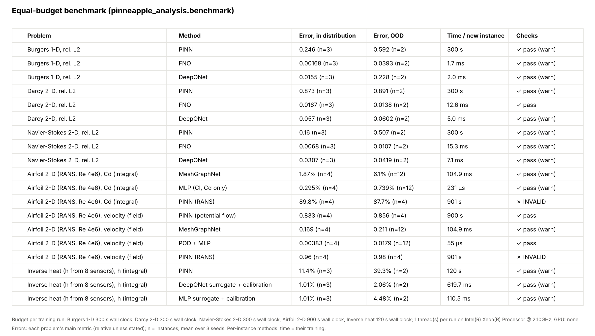

# 09 — When PINNs, when data-driven surrogates: an equal-budget benchmark

PINN vs FNO vs DeepONet (plus MeshGraphNet, MLP and POD + MLP where they apply) on five problems, every method with
**the same compute budget, the same search effort, the same hardware and the same seeds**, built on
[PINNeAPPle](https://github.com/PINNeAPPle-Labs/PINNeAPPle) and its benchmark API (`pp.benchmark`). It answers
[PINNeAPPle issue #299](https://github.com/PINNeAPPle-Labs/PINNeAPPle/issues/299).



> **CPU-only budgets.** Everything ran on one 4-core Intel Xeon @ 2.10 GHz without a GPU, one core per training run:
> **300 s** per run (Burgers, Darcy, Navier–Stokes), **900 s** (airfoil), **120 s** (inverse heat). These are small
> budgets; the error-versus-budget curves show which methods were still improving at the end.

## Headline

With simulation data available, a data-driven model trained once beat the per-instance PINN on every problem here,
under the same training budget, by a factor of 10 to 300 in error, and answered each new query in milliseconds
instead of a new training. The PINN's place in these results is where data is absent; even there, the classical solver
was faster and more accurate on every problem we could solve with one.

| Problem (n test / n OOD instances) | Best data-driven model, error in / out of distribution | PINN, same instances | Reference solver per instance |
|---|---|---|---|
| Burgers 1-D, rel. L2 (3 / 2) | FNO 0.00168 / 0.0393 | 0.246 / 0.592 | 1 s |
| Darcy 2-D, rel. L2 (3 / 2) | FNO 0.0167 / 0.0138 | 0.873 / 0.891 | 63 ms |
| Navier–Stokes 2-D, rel. L2 (3 / 2) | FNO 0.0068 / 0.0107 | 0.16 / 0.507 | 3 s |
| Airfoil, Cd rel. error (4 / 12; PINN 4 / 4) | MLP 0.295 % / 0.739 % | RANS PINN 89.8 % / 87.7 % (INVALID) | OpenFOAM 56 s |
| Airfoil, velocity rel. L2 (4 / 12; PINN 4 / 4) | POD + MLP 0.00383 / 0.0179 | potential 0.833 / 0.856, RANS 0.96 / 0.98 | OpenFOAM 56 s |
| Inverse heat, h rel. error (3 / 2) | MLP or DeepONet + calibration 1.01 % / 2.06–4.48 % | 11.4 % / 39.3 % | FV + calibration 9 s: 0.946 % / 3.31 % |

Mean over 3 seeds (± std in the tables below). The data cost is counted separately: it is repaid after 1–28 queries
(break-even column). "INVALID": the library's training gates found the RANS PINN's loss diverging in 2 of its 29
runs; it also did not converge (error no better than predicting nothing).

## Problems

| Problem | Equation and setting | Input → output | Reference solver (library) | OOD set |
|---|---|---|---|---|
| Burgers 1-D | u_t + (u²/2)_x = ν u_xx, periodic [0, 1), ν = 0.01, T = 1 | u(·, 0) → u(·, 1), 256 points | `operator_benchmarks.burgers_1d` (pseudo-spectral, ETDRK4, 1024 points, dt 1e-4) | initial amplitude ×2 (σ = 50) |
| Darcy 2-D | −∇·(a∇u) = 1, u = 0 on ∂[0, 1]², a ∈ {3, 12} | a → u, 64² | `operator_benchmarks.darcy_2d` (finite volumes, 128², pooled to 64²) | finer coefficient (τ = 6); see Limitations |
| Navier–Stokes 2-D | vorticity form, periodic unit square, ν = 1e-3, Li et al. forcing, T = 10 | ω(·, 0) → ω(·, 10), 64² | `operator_benchmarks.navier_stokes_2d_vorticity` (pseudo-spectral, ETDRK4, dt 5e-3) | smaller-scale initial vorticity (τ = 14) |
| Airfoil 2-D | RANS, k-ω SST, Re 4·10⁶, −2° to 14°, CST shapes | shape + α → Cl, Cd, fields | OpenFOAM v1912 simpleFoam (the aero app's 436-run campaign) | 12 cases: thick (NACA 0021, 2421, 4418) and high-camber (6409, 6412) sections outside the CST box, and α = −4° outside the angle range |
| Inverse heat | thin plate, 8 thermocouples, 0.5 °C noise | readings → h | finite volumes (`heat_fv_reference.plate_2d`) | h = 150, 200 W/m²K (outside the surrogates' 5–100) |

Input distributions follow Li et al. (2021), "Fourier Neural Operator for Parametric Partial Differential Equations",
ICLR ([arXiv:2010.08895](https://arxiv.org/abs/2010.08895)): Gaussian random fields with covariance
σ²(−Δ + τ²I)^(−α) (`periodic_grf`); α = 2, τ = 5, σ = 25 (Burgers); α = 2, τ = 3 thresholded to 12/3 (Darcy);
α = 2.5, τ = 7 (Navier–Stokes). All data are generated here with the library's own solvers; no external dataset is
used. Burgers uses ν = 0.01 rather than Li et al.'s ν = 0.1: on the unit interval ν = 0.1 decays the solution to
about 1.4 % of its initial amplitude by t = 1 (`results/verification.json`: max |u(0)| = 1.069, max |u(1)| = 0.0146),
which makes the operator nearly trivial.

## Methods

| Method | Library entry point | Trained on | Notes |
|---|---|---|---|
| FNO | `pinneapple_neural.architectures.neural_operators.fno` (`FourierNeuralOperator`, `FNO2d`) | simulation data | 4 layers, grid channels, relative-L2 loss, pointwise normalisation |
| DeepONet | `pinneapple_neural.architectures.neural_operators.deeponet.DeepONet` | simulation data | branch = the input field at every grid point, trunk = coordinates |
| PINN | `pinneapple_physics.pinn_solver.factory.pinn_factory` (`PINNFactory`, `PINN`) | the equations only, one instance at a time | hard initial/boundary conditions (`FourierInterpolant` for gridded initial conditions), Adam |
| MeshGraphNet | `pinneapple_design.aero.surrogate.AeroGNN` (on `pinneapple_neural`'s `MeshGraphNet`) | the OpenFOAM runs | fields + pooled Cl, Cd, Cm head (the aero app's model) |
| MLP (integrals only) | `pinneapple_design.aero.surrogate.MLPEnsemble` | the OpenFOAM runs | 5 bootstrapped MLPs on shape + α → Cl, Cd, Cm |
| POD + MLP (fields) | `pp.benchmark` built-in `mlp_fields` | the OpenFOAM runs | POD of (p, Ux, Uy) on the graph nodes, MLP from shape + α to the POD coefficients |
| PINN, potential flow (airfoil) | `PINNFactory` with Γ and the wall stream value as inverse parameters | the equations only, per geometry | Kutta condition on the trailing-edge bisector |
| PINN, RANS (airfoil) | `PINNFactory`, incompressible RANS with a mixing-length closure | the equations only, per geometry | van Driest damping, eddy viscosity frozen per step; hard no-slip |
| PINN (inverse heat) | `pinneapple_analysis.inverse_problems.heat_transfer.run_plate(budget=...)` | readings + equations, per case | h as an inverse parameter |
| Surrogate + calibration | MLP / DeepONet + golden-section search of h | finite-volume runs | the same readings as the PINN for each seed |
| FV + calibration (reference) | golden-section search through `plate_2d` itself | — | the classical approach |

## Protocol (fixed before any run)

**Hardware.** One 4-core Intel Xeon @ 2.10 GHz VM, 15 GB RAM, no GPU, torch 2.14.1 (CPU), Python 3.13 (the record
from `hardware_record()` is in every run file and in `results/hardware.json`). Every training run uses one CPU core
(`torch.set_num_threads(1)`); four runs execute concurrently whatever the method, so every method sees the same
contention.

**Budget per training run** (wall clock on one core, the primary budget): 300 s for Burgers, Darcy and
Navier–Stokes, 900 s for the airfoil, 120 s for the inverse heat problem. The loop is
`pinneapple_analysis.cost.train_within_budget`: it stops when the budget is spent, drives a cosine learning-rate
schedule by the fraction of the budget used (so a shorter budget is not a truncated longer run), and pauses the clock
during evaluation. FLOPs are counted on the first step with `count_flops` (PyTorch's per-operator formulas plus FFTs;
elementwise operations are not counted) and reported with the wall clock.

**Equal-FLOPs arm.** For the three standard problems every method is also trained to the same FLOP count: the fewest
any method used in its full wall-clock budget (median over seeds), with the wall clock capped at 3× the budget.

**Hyper-parameter search, equal for every method.** `equal_budget_search` draws 4 configurations from each method's
grid (the `space_*` of each built-in problem in `pinneapple_analysis.benchmark.builtin`), each trained for 1/3 of the
full budget with seed 0 and scored on **validation data only** (operators: the validation split; PINNs: one
validation instance that is not a test instance). The best configuration is then trained with seeds 0, 1, 2 at 1/9,
1/3 and 1× the budget (the error-versus-budget curves).

**Data-generation cost, counted separately.** The CPU time of every reference solve is measured
(`time.process_time()`, one thread) and summed over the training and validation sets. The OpenFOAM campaign is costed
at its clean per-run time (56 s per design, `results/openfoam_clean_timing.json`: 4 runs re-timed alone) because the
campaign's recorded wall times were inflated by sharing the CPU. The amortised cost per new query is
`AmortizedCost`: an operator pays the data and its training once and then one forward pass per query; a per-instance
PINN pays its training for every new query. The break-even column is the number of queries above which the operator
is cheaper in total.

**Test sets.** Standard problems: 200 held-out test inputs and 100 out-of-distribution inputs. Per-instance PINNs
are trained on test instances 0, 1, 2 and OOD instances 0, 1 only; the tables report every method on **those same
instances** (n = 3 and n = 2) next to the operators on the whole sets (n = 200 and n = 100). Airfoil: the aero app's
split (15 % of the shapes held out with all their angles, 60 runs), the four NACA polars as an independent set, and
the 12 OOD cases; the PINNs on 4 held-out runs (2 shapes × 2 angles), NACA 2412 at 4° and 4 of the OOD cases.
Inverse heat: 3 cases inside the surrogates' training range and 2 outside it.

**Metrics.** Relative L2 of the output field per instance; an integral quantity (Burgers: energy ∫u², Darcy: ∫u, the
compliance for f = 1; Navier–Stokes: enstrophy ∫ω²); Cl absolute and Cd relative error, velocity and pressure
relative L2 on the near-field graph nodes (airfoil); h relative error, maximum temperature error and hot-spot error
(inverse heat). Inference time per new instance is the median of repeated batch-1 calls on one core. Cells are the
mean ± sample standard deviation over 3 seeds of the per-seed mean over the column's n instances.

**Correctness gates and validation (library).** Before training, every (problem, method) pair passes
`pp.benchmark`'s architecture gates (shapes, FNO modes against the Nyquist limit and resolution invariance, DeepONet
shapes, MeshGraphNet permutation equivariance, PINN autograd against finite differences and the PDE residual of an
exact solution, overfitting a tiny batch); every run is checked afterwards (finite and decreasing loss, budget
enforced, identical accounting, evaluation off the clock, search on validation data only, seed spread, a determinism
spot-check). The prepared artifacts are hashed and validated with the library's validation stack (solver
verification, grid convergence, data sanity and leakage, applicability envelope, physics audit, mesh quality and y+
for the airfoil). Results: `results/table.md` (sections Validation, Trust card, Checks) and `results/validation/`.

## Results

All numbers below are in `results/table.md` / `results/table.csv` (the library's report) and come from the run files
in `results/runs/`.

### Burgers 1-D (300 s per run)

| Method | Rel. L2, test (n = 3) | Rel. L2, test, all (n = 200) | Rel. L2, OOD (n = 2) | Rel. L2, OOD, all (n = 100) | Energy rel. err (n = 3) | Time per new instance |
|---|---|---|---|---|---|---|
| PINN | 0.246 ± 0.081 | – | 0.592 ± 0.051 | – | 0.118 ± 0.024 | 300 s (training) |
| FNO | **0.00168 ± 0.00034** | 0.00328 ± 0.0003 | **0.0393 ± 0.0017** | 0.0199 ± 0.0015 | 0.00193 ± 0.0011 | 1.7 ms |
| DeepONet | 0.0155 ± 0.002 | 0.0416 ± 0.0013 | 0.228 ± 0.033 | 0.142 ± 0.0018 | 0.0109 ± 0.0059 | 2.0 ms |

### Darcy 2-D (300 s per run)

| Method | Rel. L2, test (n = 3) | Rel. L2, test, all (n = 200) | Rel. L2, OOD (n = 2) | Rel. L2, OOD, all (n = 100) | ∫u rel. err (n = 3) | Time per new instance |
|---|---|---|---|---|---|---|
| PINN | 0.873 ± 0.0041 | – | 0.891 ± 0.003 | – | 0.863 ± 0.004 | 300 s (training) |
| FNO | **0.0167 ± 0.00049** | 0.0153 ± 0.00041 | **0.0138 ± 0.0017** | 0.0172 ± 0.00053 | 0.00963 ± 0.00061 | 12.6 ms |
| DeepONet | 0.057 ± 0.0032 | 0.0577 ± 0.00082 | 0.0602 ± 0.0032 | 0.0611 ± 0.00051 | 0.0241 ± 0.0048 | 5.0 ms |

### Navier–Stokes 2-D (300 s per run)

| Method | Rel. L2, test (n = 3) | Rel. L2, test, all (n = 200) | Rel. L2, OOD (n = 2) | Rel. L2, OOD, all (n = 100) | Enstrophy rel. err (n = 3) | Time per new instance |
|---|---|---|---|---|---|---|
| PINN | 0.16 ± 0.0056 | – | 0.507 ± 0.0053 | – | 0.248 ± 0.0087 | 300 s (training) |
| FNO | **0.0068 ± 0.00089** | 0.00844 ± 0.0012 | **0.0107 ± 0.0012** | 0.0137 ± 0.0013 | 0.00197 ± 0.00097 | 15.3 ms |
| DeepONet | 0.0307 ± 0.0051 | 0.0315 ± 0.00054 | 0.0419 ± 0.0085 | 0.0417 ± 0.0019 | 0.0115 ± 0.0057 | 7.1 ms |

### Equal FLOPs (the same training FLOPs for every method)

Rel. L2 on test instance 0 (the one the PINN was trained on, n = 1) and, for the operators, on the whole test set
(n = 200); mean ± std over 3 seeds.

| Problem (FLOPs per run) | PINN | FNO | DeepONet |
|---|---|---|---|
| Burgers (2.16e12) | 0.252 ± 0.086 | **0.00186 ± 0.00013** (all: 0.00336) | 0.058 ± 0.0061 (all: 0.0561) |
| Darcy (2.10e12) | 0.846 ± 0.013 | **0.0139 ± 0.00052** (all: 0.0153) | 0.0521 ± 0.0017 (all: 0.066) |
| Navier–Stokes (2.20e12) | 0.304 ± 0.017 | **0.0111 ± 0.0021** (all: 0.00845) | 0.0524 ± 0.0019 (all: 0.041) |

The FLOP budget is the fewest FLOPs any method used in its 300 s (the PINN's on Burgers, the FNO's on Darcy and
Navier–Stokes). DeepONet executes 4–7× more counted FLOPs per second than the FNO here, so at equal FLOPs it trains
for only 44–60 s: 3.7× worse than at equal wall clock on Burgers, 1.7× on Navier–Stokes, about the same on Darcy
(0.052 vs 0.057). The FNO gets 281–400 s and stays within a factor 1.6 of
its wall-clock error (better on Darcy, worse on Navier–Stokes). The Navier–Stokes PINN gets 201 s instead of 300 s and
its error doubles (0.304 vs 0.16). The ranking (FNO, then DeepONet, then PINN) is the same as at equal wall clock on
all three problems.

### Cost: data, training, break-even

| Problem | Simulation data (core-s, train + val) | Reference solver per instance | Operator break-even vs the PINN (queries) |
|---|---|---|---|
| Burgers | 1170 | 1 s | 4.9 |
| Darcy | 69 | 63 ms | 1.2 |
| Navier–Stokes | 3843 | 3 s | 13.8 |
| Inverse heat | 14 | 9 s (calibration through the FV model) | 1.1 |

The break-even counts the operator's data **and** training against the PINN's training per new instance. Above about
5, 1 and 14 queries the operator is cheaper in total on these three problems, and it is also 1–2 orders of magnitude
more accurate. Against the classical solver itself, the PINN is not competitive on any of them in these budgets: the
reference solver is faster (63 ms to 3 s) and exact to its discretisation.

### Airfoil (RANS, Re 4·10⁶, 900 s per run)

Integral quantities. **The MLP predicts only Cl, Cd and Cm** from the shape parameters and the angle ("integrals
only" in the field table): a scalar regressor trained directly on the scalars is expected to beat any field model on
them, so compare field models with each other on fields, and read the integral columns with that in mind.

| Method | Cl abs. err, test (n = 4) | Cd rel. err, test (n = 4) | Cl abs. err, all test (n = 60) | Cd rel. err, all test (n = 60) | Cd rel. err, NACA polars (n = 36) | Cl abs. err, OOD (n = 12) | Cd rel. err, OOD (n = 12) |
|---|---|---|---|---|---|---|---|
| MLP (integrals only) | **0.00107 ± 0.00031** | **0.295 % ± 0.15 %** | 0.00227 ± 0.00038 | 0.566 % ± 0.21 % | 0.456 % ± 0.013 % | 0.00462 ± 0.00095 | 0.739 % ± 0.25 % |
| MeshGraphNet | 0.0342 ± 0.016 | 1.87 % ± 0.55 % | 0.0333 ± 0.0039 | 2.16 % ± 0.31 % | 2.95 % ± 0.82 % | 0.0839 ± 0.032 | 6.1 % ± 0.85 % |
| PINN, potential flow | 0.78 ± 0.099 | 98.7 % (zero drag by construction) | – | – | – | 0.376 (n = 4, seed 0) | 99 % |
| PINN, RANS | 0.875 ± 0.0013 | 89.8 % ± 4.2 % | – | – | – | 0.48 (n = 4, seed 0) | 87.7 % |
| Panel method (inviscid reference, no data) | 0.144 | 100 % | 0.124 | 100 % | 100 % | 0.126 | 100 % |

Fields on the near-field graph nodes:

| Method | Velocity rel. L2, test (n = 4) | Pressure rel. L2, test (n = 4) | Velocity, all test (n = 60) | Velocity, NACA polars (n = 36) | Velocity, OOD (n = 12) | Pressure, OOD (n = 12) |
|---|---|---|---|---|---|---|
| POD + MLP | **0.00383 ± 0.0003** | **0.00929 ± 0.0015** | 0.00496 ± 0.00033 | 0.00466 ± 0.00021 | 0.0179 ± 0.0035 | 0.0581 ± 0.019 |
| MeshGraphNet | 0.169 ± 0.049 | 0.479 ± 0.15 | 0.169 ± 0.047 | 0.177 ± 0.047 | 0.211 ± 0.023 | 0.724 ± 0.049 |
| PINN, potential flow | 0.833 ± 0.012 | 1.98 ± 0.009 | – | 0.78 (n = 1) | 0.856 (n = 4, seed 0) | 2.84 |
| PINN, RANS | 0.96 ± 0.0043 | 1.02 ± 0.017 | – | 0.959 (n = 1) | 0.98 (n = 4, seed 0) | 1.03 |
| Panel method (inviscid reference) | 0.651 | 0.435 | 0.65 | 0.652 | 0.624 | 0.358 |

OOD: 12 OpenFOAM cases outside the training design space (NACA 0021, 2421, 4418, 6409, 6412 at 2° and 6°, and NACA 2412
and 0012 at −4°, below the −2° to 14° range); the per-geometry PINNs on 4 of them (one per kind of departure). The
data cost is the 436-run campaign at its clean timing (6.8 core-hours); the surrogates repay it after 28 queries
against the PINN (900 s each), and OpenFOAM itself takes 56 s per design.

**Why the PINNs failed here, and what was checked.** Both PINNs need no data and solve one geometry per training run.
- *The equations are right.* The library's gate evaluates each PINN's own residuals on exact solutions that exercise
  every term (a harmonic stream function; Kovasznay flow with an eddy viscosity) and on sign-flipped copies: residuals
  0 and 2e-30, flipped 16 and 2.2. The potential-flow PINN's lift misses the panel method's (the exact solution of the
  same inviscid equations) by 0.78 ± 0.31 over 35 runs, so it did not solve its own equations either.
- *Not the budget.* PINN-only budget study (seed 0, `figures/fig3_airfoil_pinn_budget_study.png`): the RANS PINN's
  velocity error is 0.96–0.99 at 100 s, 900 s, 1 h and 4 h; the potential PINN's gets worse from 100 s (0.59) to 1 h
  (0.90) while its circulation drifts (Cl error 0.63 → 1.12).
- *Partly the setup* (900 s on NACA 2412 at 4°, seed 0): for the potential PINN, wall and Kutta weights of 1 instead of
  10 lower the velocity error from 0.81 to 0.51 and a learning rate of 1e-3 the Cl error from 0.44 to 0.24, so a wider
  search would have helped it; Adam → L-BFGS for the last 30 % changes little. For the RANS PINN nothing moved the
  velocity error (0.94–0.97).
- *The RANS PINN collapses to zero flow.* u = v = 0, p = constant satisfies the RANS equations exactly; the network
  reaches it near the body (mean velocity 0.01 where OpenFOAM has 0.71). An exact far field and collocation even in log
  r did not prevent it (300 s tests, `.agent/FAILED_APPROACHES.md` at the repository root). The 45 % of collocation
  points within 0.01 c of the wall come from the O-grid itself.
These are known failure modes of PINNs: the loss terms' gradients are badly balanced (Wang, Teng & Perdikaris 2021)
and the optimisation, not the representation, fails on stiff or multi-scale problems (Krishnapriyan et al. 2021).
RANS PINNs that work (Eivazi et al. 2022) use data on the boundaries, which a data-free PINN does not have.


### Inverse heat (h from 8 sensors, 120 s per run)

| Method | h rel. err, in range (n = 3) | h rel. err, out of range (n = 2) | Hot-spot err °C (n = 3) | Max field err °C, in range (n = 3) | Time per new case |
|---|---|---|---|---|---|
| PINN | 11.4 % ± 5.3 % | 39.3 % ± 1.3 % | 0.24 ± 0.13 | 1.1 ± 0.31 | 120 s (training) |
| DeepONet surrogate + calibration | 1.01 % ± 0.29 % | **2.06 % ± 1.2 %** | 0.129 ± 0.014 | 0.524 ± 0.1 | 620 ms |
| MLP surrogate + calibration | 1.01 % ± 0.63 % | 4.48 % ± 2.9 % | 0.189 ± 0.09 | 0.235 ± 0.096 | 111 ms |
| FV model + calibration (reference) | **0.946 % ± 0.55 %** | 3.31 % ± 2 % | 0.166 ± 0.097 | 0.168 ± 0.098 | 9 s |

In range, both surrogates match the classical calibration through the finite-volume model itself (about 1 % in h,
the level the 0.5 °C sensor noise allows), at 1–7 % of its cost per case; outside their training range they stay
within a few per cent. The PINN, which must learn the field and h
for every case in 120 s, is an order of magnitude worse and was still improving at the full budget (0.233 at 1/3 of
the budget, 0.114 at the full budget).

## Where each method wins and where it loses

| Method | Wins | Loses |
|---|---|---|
| FNO | the three operator-learning problems, in and out of distribution, at equal wall clock and at equal FLOPs; 2–15 ms per query | needs a regular grid and simulation data; still improving at the full budget on Burgers, Darcy and Navier–Stokes |
| DeepONet | 2–7 ms per query; second on every operator problem; best h out of range in the inverse heat problem (2.06 %) | 3–9× the FNO's error; out of distribution on Burgers it degrades most (0.228) |
| MeshGraphNet | fields and integrals on any mesh from one model | on this low-dimensional (CST) design space, the POD + MLP field baseline is about 40× more accurate and 2000× faster per query |
| MLP (integrals) | the airfoil integrals: Cd 0.3 % in distribution, 0.7 % out of it | gives no fields |
| POD + MLP | the airfoil fields: velocity 0.4 % in distribution, 1.8 % out of it | relies on the shapes having a low-dimensional parametrisation |
| PINN | needs no simulation data; the Navier–Stokes PINN reached 0.16 and was still improving | every problem here: 1–3 orders of magnitude behind the data-driven models, 300–900 s per new instance, and slower and less accurate than the reference solver; the airfoil PINNs did not learn the flow |
| Surrogate + calibration (inverse heat) | the classical calibration's accuracy at 1–7 % of its cost per case, also out of the training range | needs the forward model's runs (14 core-s here) |

The classical solver was never beaten on its own ground: for one new instance it was faster than training any model
here and exact to its discretisation. The learned models pay off when many queries follow (break-even 1–28).

## What the library's gates and advisor said

`pp.benchmark` ran its gates and advisor on this experiment (full output: `results/table.md`, sections Diagnostics,
Validation, Trust card and Checks; `results/summary.json`). What they caught, and what changed (details in
`.agent/FAILED_APPROACHES.md` at the repository root):

- **Errors.** The airfoil RANS PINN: did not converge (velocity error 0.96 ≥ 0.9) and its loss diverged in 2 of 29
  runs (to 10–20× its minimum): the row is INVALID. Nothing else failed an error-level gate.
- **Budget-limited.** FNO (Burgers, Darcy, Navier–Stokes), DeepONet (Burgers), MeshGraphNet (airfoil) and the PINNs on
  Navier–Stokes and the inverse heat problem were still improving at the full budget (36–94 % lower error for 3× the
  budget), with the exact configuration edit to try (e.g. `budget.wall_s: 300 → 900`).
- **OOD sets that are not OOD.** Darcy's OOD inputs are inside the training distribution (9 % outside by PCA and
  Mahalanobis distance; 1 of 100 outside the applicability envelope); Burgers' and Navier–Stokes' OOD sets are only
  partly outside (20 and 23 of 100). Read those OOD columns as a second test set.
- **Learning-rate symptoms.** Loss spikes in the second half (MeshGraphNet, RANS PINN, the inverse-heat MLP) and no
  early progress (Navier–Stokes FNO, RANS PINN), with the suggested grid.
- **Bugs the gates found before publishing:** an over-strict "overfits a tiny batch" gate that blocked DeepONet, a
  "did not learn" gate that judged the short runs, an oscillating grid-convergence index counted as a pass, a y+ check
  that returned NaN, a preflight that did not recognise `freestreamPressure`, and an airfoil convergence metric (Cd)
  that a potential-flow PINN fails by construction. All were fixed in the library with tests; none changed a training
  run.
- **Validation (library stack).** Solver verification passed on all five problems: Burgers against Cole–Hopf (2.96e-13)
  with ETDRK4 order 3.99; the manufactured Darcy solution (order 2.0); a Taylor–Green vortex (1.7e-15); the airfoil
  campaign (93 % of 436 runs converged; NACA 0012 Cd 0.00871 against the NASA Turbulence Modeling Resource; lift slope
  6.37 /rad, 93 % of the panel method's 6.84); grid convergence of every reference solver (airfoil Cd: p = 2.79,
  GCI 1.2 %). The airfoil case passes preflight (warnings: 4 faces above 70° non-orthogonality, k fixed at the wall,
  which suits the resolved wall: first-cell y+ 0.6), mesh quality and y+; the physics
  audit warns that 14° is outside the attached-flow assumption of the RANS model.

## Limitations

- **CPU-only, small budgets.** One core per run, 120–900 s. Several methods were still improving; a GPU and longer
  budgets would change the absolute numbers and possibly the margins, not, on this evidence, the ranking.
- **Few PINN instances.** Per-instance PINNs ran on 3 test and 2 OOD instances per standard problem (4 + 1 + 4 for the
  airfoil); the tables show every method on those same instances next to the operators on the full sets.
- **OOD sets** for Darcy (and partly Burgers and Navier–Stokes) are not out of distribution (above). The airfoil OOD
  set (12 cases outside the design space) and the inverse heat out-of-range cases are.
- **Search breadth.** Four configurations per method. The setup audit shows the potential-flow PINN would gain from
  other loss weights and a lower learning rate; its result is not the best a PINN can do on this problem.
- **The airfoil PINNs** are data-free and one geometry per run; a RANS PINN with boundary data or a better closure is a
  different method, not tested here.
- **Weight decay.** The first operator search used Adam weight decay 1e-4, which froze the Navier–Stokes FNO at the
  mean; it was re-run without (the first attempt is kept in `results/first_attempt_wd1e-4/`).
- **Timing.** The OpenFOAM campaign shared the CPU with other jobs; its cost is the clean per-run time (56 s, 4 runs
  re-timed alone). Interrupted runs (container restarts) resumed from checkpoints with their budget accounting.
- **FLOP counts** include PyTorch's per-operator formulas and FFTs but not elementwise operations.

## Reproduce

```bash
bash reproduce.sh            # everything: OpenFOAM campaign, data, runs, library prepare/validation/gates, report
EXP09_SMOKE=1 bash reproduce.sh   # tiny sizes and budgets: checks the pipeline in minutes
```

It needs the PINNeAPPle library checked out next to this repository at the commit in `env/PINNEAPPLE_COMMIT`, the
Python packages in `env/requirements.lock`, and OpenFOAM v1912 (Ubuntu 24.04: `apt-get install openfoam`) for the
airfoil. Runs are cached in `results/runs/`: an interrupted run resumes, and finished jobs are not repeated.
The library part alone, on the same artifacts:

```bash
cd src && python bench09.py prepare && python bench09.py run    # results/table.md, table.csv, summary.json, figures/
```

## Files

| Path | Content |
|---|---|
| `src/bench09.py` | the whole experiment as a `pp.benchmark` configuration (prepare, run, report); everything else is library code |
| `src/common.py` | paths |
| `results/runs/` | one JSON per training job (spec, result, hardware, wall time) |
| `results/table.md`, `table.csv`, `summary.json` | the library's report |
| `results/prepared/`, `results/validation/` | artifact manifests (hashes, cost), checks and validation |
| `figures/` | the figures shown here |
| `env/` | environment lock and the library commit |

## References

- Li, Kovachki, Azizzadenesheli, Liu, Bhattacharya, Stuart, Anandkumar (2021). Fourier Neural Operator for
  Parametric Partial Differential Equations. ICLR. [arXiv:2010.08895](https://arxiv.org/abs/2010.08895).
- Lu, Jin, Pang, Zhang, Karniadakis (2021). Learning nonlinear operators via DeepONet based on the universal
  approximation theorem of operators. Nature Machine Intelligence 3, 218–229.
- Krishnapriyan, Gholami, Zhe, Kirby, Mahoney (2021). Characterizing possible failure modes in physics-informed
  neural networks. NeurIPS. [arXiv:2109.01050](https://arxiv.org/abs/2109.01050).
- Wang, Teng, Perdikaris (2021). Understanding and mitigating gradient flow pathologies in physics-informed neural
  networks. SIAM Journal on Scientific Computing 43(5). [doi:10.1137/20M1318043](https://doi.org/10.1137/20M1318043).
- Eivazi, Tahani, Schlatter, Vinuesa (2022). Physics-informed neural networks for solving Reynolds-averaged
  Navier–Stokes equations. Physics of Fluids 34, 075117. [doi:10.1063/5.0095270](https://doi.org/10.1063/5.0095270).
