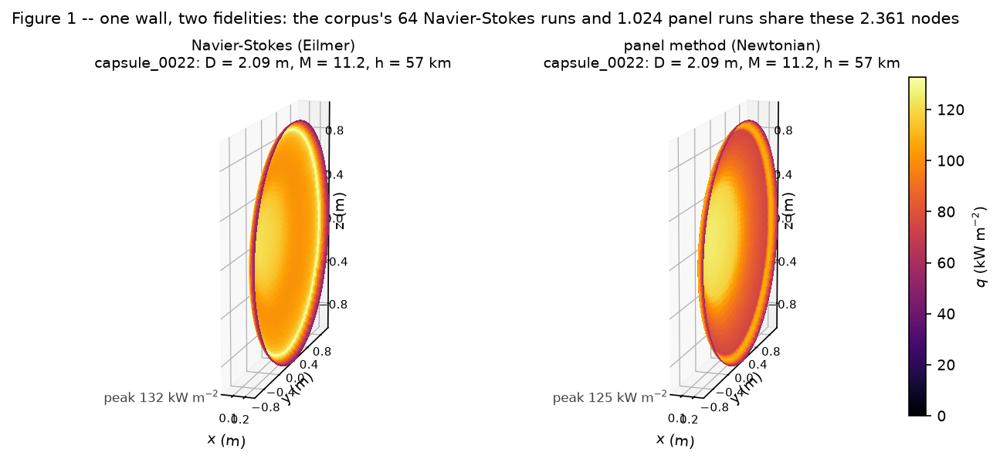
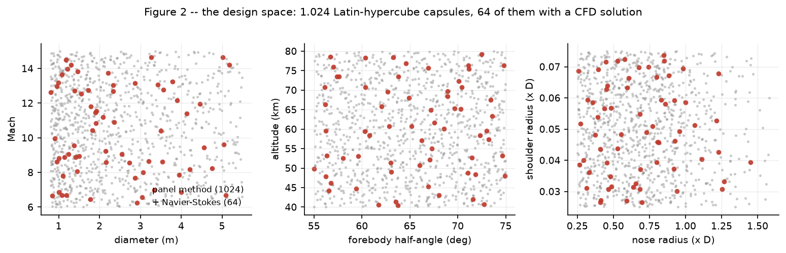
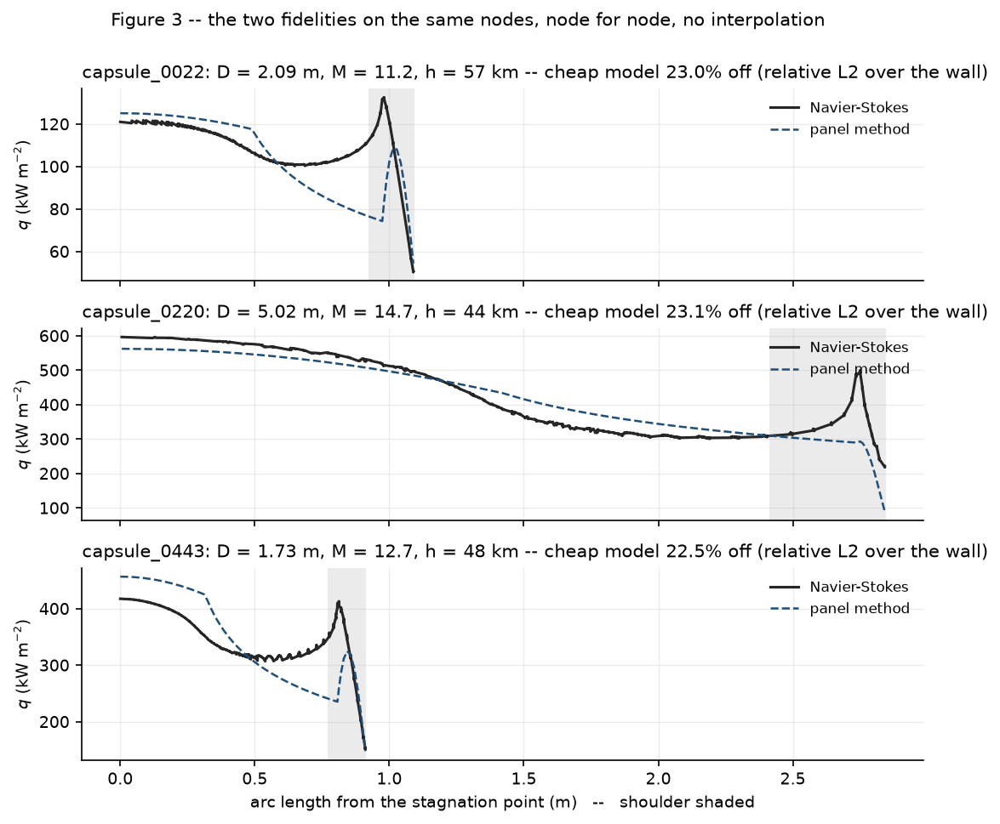
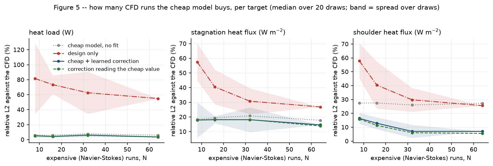
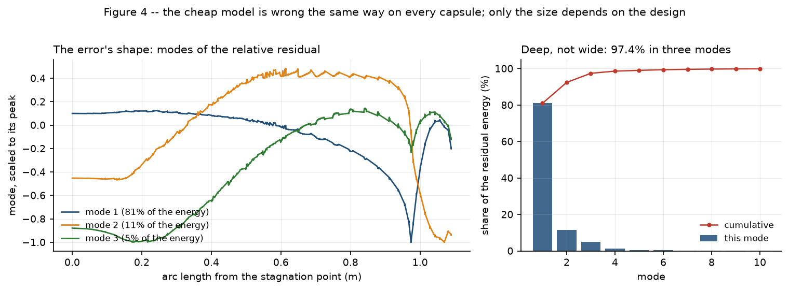
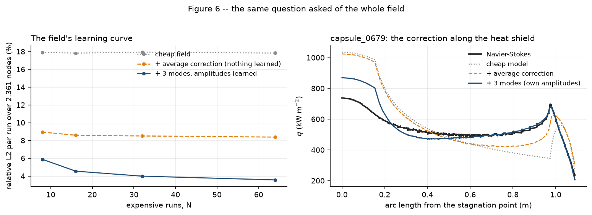

# Report — what the cheap model buys

**Case 10, `experiments/10_multifidelity_capsule`.** One question, asked of an aerothermodynamics corpus that has two
fidelities of the same wall: *how many expensive runs does a cheap model make unnecessary, and where?*

The short answer, in the two numbers that matter: on the heat shield's **shoulder**, where the panel method is
structurally blind, eight Navier–Stokes runs take its error from **27.4 % to 16.4 %** and sixty-four take it to
**7.0 %**. On a well-behaved scalar such as the heat load, the same eight runs buy almost nothing (**5.85 % → 5.04 %**),
because there is less left to correct.

---

## 1. The dataset

[capsule-aeroheating](https://huggingface.co/datasets/bijective/capsule-aeroheating) (Bijective Systems, version 4,
**CC BY 4.0**). One file, `vehicle_capsule_multifidelity.gamut`, 77 MB, read with the Apache-2.0 `bijective-gamut`
package.

| | |
|---|---|
| Capsules | 1.024 members, each one shape at one flight condition (a Latin hypercube over six inputs) |
| Runs | 1.088: **1.024** from a modified-Newtonian panel method, **64** of those also from second-order laminar Navier–Stokes (Eilmer) |
| Wall | 2.361 nodes and 4.640 triangles, **the same on every capsule and at both fidelities** |
| Inputs | diameter 0.8–5.5 m, nose radius 0.25–1.6 × D, forebody half-angle 55–75°, shoulder radius 0.025–0.075 × D, Mach 6–15, altitude 40–80 km |
| Fields | heat flux, pressure, arc length, film coefficient, recovery enthalpy, the boundary-layer edge state — per node |
| Scalars | heat load, stagnation/peak/shoulder/mean heat flux, forebody pressure drag, the freestream state |
| Held fixed | calorically perfect air, laminar, 300 K wall, zero incidence, heat shield only (no afterbody or wake) |
| Cost | panel method: seconds. Navier–Stokes: **1.2 h to 5.4 h** per run on six cores, median 1.9 h |

The property that makes this a multi-fidelity benchmark rather than two datasets: **node *i* is the same point of the
heat shield on every capsule and at both fidelities**. The coordinates differ per capsule — they are metres at real
size — but the correspondence does not, so the difference between the fidelities is a subtraction at each node with no
interpolation between meshes. No other public CFD corpus we read has it.



*Figure 1 — one capsule's heat shield, coloured by each fidelity. The same 2.361 nodes; the peak moves by 5 % between
the two, and the rim ring is where they disagree.*



*Figure 2 — the 1.024 capsules in the six inputs, with the 64 that have a CFD solution marked. The CFD subset spreads
over the whole design but is not itself a Latin hypercube: the corpus could not run six selected shapes, so the
subsample is thinner near Mach 15, near 80 km and for the largest capsules.*

---

## 2. Method

A learning curve, not a leaderboard. For a budget `N`, `N` of the 64 expensive runs are drawn at random (20 draws, one
seed) and every strategy is fitted on them and scored on the remaining `64 - N` — the same held-out runs for every
strategy of a draw, so the rows are paired. At `N = 64` there is nothing to hold out, so each run is predicted from the
other 63 (leave-one-out): a different question, and the only honest way to put the full budget on the same axis.

The regressor is **kernel ridge with an RBF kernel, in closed form**: no optimiser state, no epochs, and it works at
`N = 8`, where a network has nothing to learn from. The length scale is the median pairwise distance of the training
designs. Inputs are the six variables scaled to `[-1, 1]` **by the bounds the file declares**, not by the sample's
range.

| per capsule | what it is |
|---|---|
| `low_fidelity` | the cheap model's own value — no fit. The baseline a correction has to beat |
| `geometry` | a surrogate of the target from the six inputs alone: "what if there were no cheap model" |
| `difference` | a surrogate of `y_high - y_low` from the six inputs: the co-kriging model of the two-fidelity case |
| `residual_feature` | the same, with the cheap model's value among the inputs |

| per field (2.361 nodes) | what it is |
|---|---|
| `low_fidelity` | the cheap field, on the same nodes |
| `mean_correction` | the cheap field plus the average **relative** residual of the training runs: one shape, nothing learned from the design |
| `pod_correction` | the cheap field plus 3 modes of the relative residual, each amplitude learned from the six inputs |

The relative residual divides each run's residual by the magnitude of its own cheap field, and the prediction multiplies
back by the cheap run's magnitude — legitimate at every design, because the cheap model runs everywhere. This is the
step that makes the field model work: the heat flux spans **175×** across designs, so on the raw residual the
coefficients span 175× too, and a regression on six inputs cannot learn a quantity whose scale the design sets. The
first attempt, without it, reported 96 % and 5 494 % error.

---

## 3. Results

### 3.1 The two fidelities, on the same nodes



*Figure 3 — three capsules, cheap model (dashed) against Navier–Stokes (solid) along the arc from the stagnation point.
The cheap model is systematically high on the nose, low over the cone, and it misses the shoulder peak entirely: the
flow there is set by the shoulder geometry, which a panel method that sees only the nose radius cannot represent.*

### 3.2 How many CFD runs the cheap model buys



*Figure 5 — relative L2 against the CFD, per target, median over 20 draws; the band is the spread over draws.*

| target | cheap model | corrected, N=8 | corrected, N=64 | design only, N=64 |
|---|---|---|---|---|
| heat load | 5.85 % | 5.04 % | 3.55 % | 54.86 % |
| stagnation heat flux | 18.28 % | 17.87 % | 14.60 % | 26.85 % |
| **shoulder heat flux** | **27.43 %** | **16.41 %** | **7.01 %** | 25.55 % |

Three readings:

* **Where the cheap model is already good, eight runs buy little.** The heat load is 5.85 % off and eight runs take it
  to 5.04 %: there is less left to correct. A single "multi-fidelity gain" number would hide exactly this.
* **Where it is structurally wrong, they buy a lot.** The shoulder goes 27.4 % → 16.4 % with eight runs, and 7.0 % with
  sixty-four: a factor of four.
* **The design alone never gets close** (25 % to 55 %). Knowing the diameter, the nose radius and the Mach number does
  not tell you the heating — which is the measurement behind an engineering model existing at all.

### 3.3 The error is a shape, not a table



*Figure 4 — the first three modes of the relative residual along the arc, and the share of the residual energy they
carry: **81.0 %, 92.4 %, 97.4 %**.*

That is why a handful of runs is enough: the cheap model is wrong **the same way on every capsule**, and only the size
of the error depends on the design.



*Figure 6 — left: the field's learning curve over the whole 2.361-node field. Right: the worst capsule of the corpus
(`capsule_0679`, the same one the dataset card highlights for a +40.3 % stagnation heat flux), with the average
correction and the three-mode correction against the CFD.*

| the heat-flux field, relative L2 per run | |
|---|---|
| cheap field | 17.91 % |
| + average correction, **nothing learned** | **8.94 %** |
| + 3 modes, amplitudes learned, N=8 | 5.88 % |
| + 3 modes, amplitudes learned, N=64 | **3.57 %** |

Two readings kept apart on purpose. The *average* correction — one shape, no dependence on the design at all — already
halves the field's error. That is not learning: it is the cheap model being wrong in the same direction everywhere.
What the design buys on top of it is the amplitude, and that is what the eight runs pay for. In Figure 6's right panel
the average correction is visibly a compromise: it over-corrects the nose of that particular capsule, while the
three-mode correction follows the CFD over the whole shield.

---

## 4. Code

Everything below is in the two pull requests that carry this work; the case's `env/PINNEAPPLE_COMMIT` pins the library
commit the numbers were produced with.

| what | where |
|---|---|
| Reader: pairing the fidelities, the wall, the bundles | [`pinneapple_data/datasets/capsule_aeroheating.py`](https://github.com/PINNeAPPle-Labs/PINNeAPPle/blob/feat/capsule-aeroheating/pinneapple_data/datasets/capsule_aeroheating.py) — `pair_fidelities` (213), `wall` (273), `load_bundle` (314), `field_pair` (470), `field_channels` (494), `field_samples` (518), `schema_unit` (170) |
| Physics checks the corpus allows | [`pinneapple_data/datasets/capsule_aeroheating_physics.py`](https://github.com/PINNeAPPle-Labs/PINNeAPPle/blob/feat/capsule-aeroheating/pinneapple_data/datasets/capsule_aeroheating_physics.py) — `newtonian_pressure` (132), `axial_spread` (162), `heat_load` (191), `radiative_equilibrium_temperature` (213), `checks` (275) |
| The multi-fidelity curves | [`pinneapple_data/multifidelity.py`](https://github.com/PINNeAPPle-Labs/PINNeAPPle/blob/feat/capsule-aeroheating/pinneapple_data/multifidelity.py) — `FidelityPair` (51), `KernelRidge` (134), `learning_curve` (242), `FieldPair` (323), `residual_rank` (376), `field_learning_curve` (400) |
| The library example (both curves, 20 metrics, 9 checks) | [`examples/capsule_aeroheating/`](https://github.com/PINNeAPPle-Labs/PINNeAPPle/tree/feat/capsule-aeroheating/examples/capsule_aeroheating) |
| Tests | `tests/pinneapple_data/test_capsule_aeroheating.py`, `test_capsule_aeroheating_physics.py`, `test_multifidelity.py` — 78 tests |
| This case | [`src/run.py`](src/run.py) (the curve), [`src/figures.py`](src/figures.py) (every figure above, from the data), [`results/curve.json`](results/curve.json) (every median and spread, with the protocol) |

Pull requests: [PINNeAPPle #1855](https://github.com/PINNeAPPle-Labs/PINNeAPPle/pull/1855) (the reader, the checks and
the curves) on top of [PINNeAPPle #1857](https://github.com/PINNeAPPle-Labs/PINNeAPPle/pull/1857) (the physics-data
schema it builds on), and this case as
[PINNeAPPle-Benchmark #11](https://github.com/PINNeAPPle-Labs/PINNeAPPle-Benchmark/pull/11).

## 5. Reproducing it

```bash
git clone https://github.com/PINNeAPPle-Labs/PINNeAPPle-Benchmark && cd PINNeAPPle-Benchmark
git checkout exp10-multifidelity-capsule

# the library at the pinned commit, next to the benchmark repository (or set $PINNEAPPLE_REPO)
git clone https://github.com/PINNeAPPle-Labs/PINNeAPPle ../PINNeAPPle
cd ../PINNeAPPle && git checkout "$(sed -n 1p ../PINNeAPPle-Benchmark/experiments/10_multifidelity_capsule/env/PINNEAPPLE_COMMIT)"
pip install -e . bijective-gamut matplotlib

cd ../PINNeAPPle-Benchmark/experiments/10_multifidelity_capsule
bash reproduce.sh          # downloads 77 MB once, then ~2 min: results/curve.json
python src/figures.py      # every figure in this report, from the same data
bash reproduce.sh smoke    # 16 runs, 2 draws: a pipeline check in seconds
```

`src/figures.py` draws every panel from the corpus and from `results/curve.json`; no number in a figure is typed in by
hand, so a figure and a table cannot drift apart.

## 6. Limitations, stated

* **64 expensive runs is a small sample.** The 20 draws give the spread of the *split*, not an uncertainty of the
  corpus: the high-fidelity values carry no error bars of their own, and the corpus says its grids were not refined case
  by case.
* **The field model is low rank.** It is not a comparison against a network free to choose every node's correction. That
  is a choice, argued from the mode structure (97 % in three modes) — not a claim of superiority.
* **The three scalar targets are summaries of the same field.** They are correlated, not three independent problems.
* **No architecture search, no tuning.** One regressor, one kernel, one length-scale heuristic: the rows compare
  *strategies*, not models.
* **No extrapolation split.** Every strategy is scored inside the sampled box. The corpus has a sparse corner — six
  selected shapes could not be run — so an extrapolation split would measure the corpus's gap as much as the model.
* **The cheap model is the corpus's own panel method.** Its biases are what is being corrected, not an independent
  implementation.

## 7. Licence and citation

The data and its figures are **CC BY 4.0**; the reader is Apache-2.0; this case is Apache-2.0 like the repository.

```bibtex
@misc{bijective_capsule_aeroheating_2026_v4,
  title        = {Capsule forebody aeroheating, Newtonian and Navier--Stokes {CFD}},
  author       = {{Bijective Systems}},
  year         = {2026},
  version      = {4},
  howpublished = {\url{https://huggingface.co/datasets/bijective/capsule-aeroheating}}
}
```
